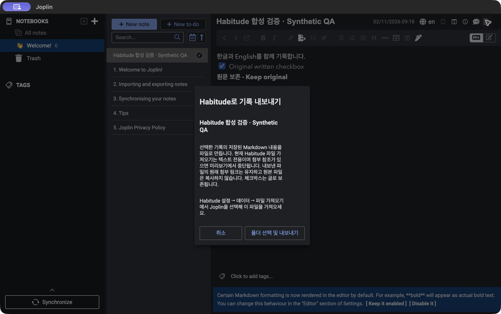

# Habitude for Joplin · 0.1.2

한국어: Joplin에서 고른 Markdown 기록 하나를 Habitude가 가져올 수 있는 파일로 내보냅니다. **Tools → Habitude: 선택 기록 내보내기** 또는 기록 도구 모음의 내보내기 버튼을 누르고, 제목을 확인한 뒤 저장할 폴더를 고릅니다. 저장한 파일은 Habitude 웹(habitude.ai/app)의 **설정 → Obsidian 일기 가져오기 → Markdown 파일 선택**에서 고르고, 미리 본 뒤 가져옵니다. 파일에 적힌 작성 시각(`created`)이 기록 날짜가 되고, 제목은 Joplin 노트 제목을 씁니다. **Tools → Habitude 열기**는 본문을 보내지 않고 Habitude 웹사이트만 엽니다. 플러그인 설정의 언어에서 한국어와 English를 고를 수 있습니다.

English: Select one Markdown note and choose **Tools → Habitude: Export selected note**, or the export button in the note toolbar. Check the title and pick a folder. Then open Habitude on the web (habitude.ai/app), go to **Settings → Import Obsidian journal notes → Choose Markdown files**, pick the saved file, look over the preview and import. The note's creation time (`created`) becomes the entry date and the Joplin title becomes its heading. **Tools → Open Habitude** opens the Habitude website without any note content. Choose Korean or English in the plugin's settings.

## Install / 설치

From Joplin's plugin list, once the package is listed there: Joplin desktop → Settings/Preferences → Plugins → search for **Habitude** → Install, then restart Joplin.

From a file: Settings/Preferences → Plugins → Advanced settings → Install from file → choose `habitude-joplin-0.1.2.jpl` from the GitHub release, then restart Joplin.

Joplin 목록에 올라간 뒤에는 데스크톱 Joplin의 설정 → 플러그인에서 **Habitude**를 검색해 설치하고 Joplin을 다시 시작합니다. 파일로 설치할 때는 설정 → 플러그인 → 고급 설정 → 파일에서 설치에서 GitHub 릴리스의 `.jpl`을 고릅니다. 모바일 Joplin은 지원하지 않습니다.

## What is preserved

- Reads only the selected note after the export command. The current saved Markdown is exported; finish typing and let Joplin save before exporting.
- Uses the native note ID plus real creation/modification timestamps for repeat imports. Local notes are never edited or deleted.
- Creates a new UTF-8 file exclusively (`wx`, mode `0600`). An existing destination is never overwritten.
- Attachment/resource links remain original Joplin links. Their binary originals are **not** copied; this export is not an attachment backup.
- Habitude brings in text only. The web journal import leaves images in the body out of the entry and shows how many it left out.
- No account, analytics, automatic network request, background graph scan or habit-completion mapping.
- Export limit: 1 MiB and 30,000 lines. Encrypted placeholders, HTML notes and unsupported input stop with a fixed message.

이 기능은 직접 파일을 주고받는 연결입니다. 자동·실시간·양방향 동기화가 아닙니다. 첨부 원본이 필요하면 Joplin의 원본 내보내기도 함께 보관해 두세요.

## Verification

In official Joplin **3.7.22**, an isolated desktop profile was used to install the plugin, restart the host, open the real toolbar and confirmation dialog, and export a synthetic Korean/English note with a written checkbox. The original note and native timestamps stayed unchanged. The resulting Markdown was imported into a disposable Habitude Vault, then reimported without a duplicate. That host check covered 0.1.0, whose runtime 0.1.1 kept byte for byte. Version 0.1.2 changes only the wording of the review dialog and the saved message, which now point to the web import; host API and package tests pass, and the 0.1.2 dialog has not yet been opened in a real Joplin. Mobile and other host versions have not been tested in the actual app.

Official APIs used: [workspace.selectedNote](https://joplinapp.org/api/references/plugin_api/classes/joplinworkspace.html#selectednote), [dialogs](https://joplinapp.org/api/references/plugin_api/classes/joplinviewsdialogs.html), [commands](https://joplinapp.org/api/references/plugin_api/classes/joplincommands.html), [plugin manifest](https://joplinapp.org/help/api/references/plugin_manifest/). The package is an uncompressed portable tar with `manifest.json` and `index.js`, matching the [official generator's package format](https://github.com/laurent22/joplin/blob/dev/packages/generator-joplin/generators/app/templates/webpack.config.js).

## Changes

- 0.1.2: the review dialog and the saved message point to the Habitude web import (Settings → Import Obsidian journal notes). Plugin icons and a screenshot are declared for Joplin's plugin website.
- 0.1.1: packaging for Joplin's npm plugin list (`publish/`). Runtime unchanged from 0.1.0.
- 0.1.0: first release.

## In the actual desktop app

This is a genuine isolated host screenshot with synthetic writing. It shows version 0.1.1, whose dialog pointed to the Mac importer. It does not show private notes.

## Build this source repository

Run `npm test`, `npm run build`, then `npm run verify`. No npm dependencies are required. The builder regenerates `index.js`, a versioned portable `.jpl` in `dist/`, and the official registry pair `publish/ai.habitude.export.jpl` plus `publish/ai.habitude.export.json`. The metadata contains the archive SHA-256; npm includes both generated files because Joplin's list installs packages with lifecycle scripts disabled. `npm publish` first runs the same tests, build and verification.
